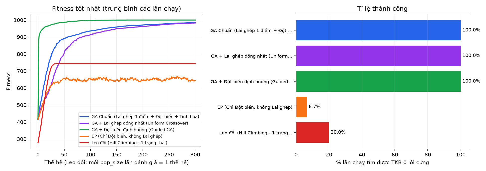

# Kết quả thực nghiệm 30 lần chạy độc lập

- Bài toán: 31 lớp học phần (52 buổi/tuần, 17 buổi thực hành) | 10 giảng viên | 5 phòng | 6 lớp SV | 24 khung giờ (6 ngày x 4 ca)
- Tham số: pop_size=200, generations=300, mutation_rate=0.05, elitism=2, tournament k=3, dừng sớm khi đạt 1000 điểm hoặc 150 thế hệ không cải thiện
- Leo đồi: ngân sách đánh giá bằng GA (pop_size x generations); mỗi pop_size lần đánh giá = 1 'thế hệ'.

| Biến thể / Thuật toán | Tỉ lệ tìm ra TKB 0 lỗi cứng | Tỉ lệ đạt 1000 điểm (0 lỗi mềm) | Fitness TB đạt được | Fitness tốt nhất / kém nhất | Thế hệ đầu tiên có TKB hợp lệ (TB) | Số thế hệ hội tụ TB | Thời gian TB (s) | Nhận xét đặc trưng |
|---|---|---|---|---|---|---|---|---|
| GA Chuẩn (Lai ghép 1 điểm + Đột biến + Tinh hoa) | 30 / 30 (100.0%) | 1 / 30 (3.3%) | 984.3 ± 9.3 | 1000.0 / 956.9 | 32.2 | 250.4 | 26.25 | Lai ghép 1 điểm ghép các cụm lịch tốt của Cha và Mẹ; tinh hoa giữ không tụt fitness. |
| GA + Lai ghép đồng nhất (Uniform Crossover) | 30 / 30 (100.0%) | 1 / 30 (3.3%) | 982.6 ± 9.7 | 1000.0 / 956.9 | 57.3 | 269.9 | 11.74 | Trộn gen 50/50 khám phá rộng nhưng dễ phá vỡ các 'khối gen' tốt nằm liền nhau. |
| GA + Đột biến định hướng (Guided GA) | 30 / 30 (100.0%) | 29 / 30 (96.7%) | 999.8 ± 0.9 | 1000.0 / 995.0 | 1.4 | 99.9 | 22.92 | Đột biến nhắm thẳng vào các buổi đang trùng lịch + chọn phương án ít xung đột nhất. |
| EP (Chỉ Đột biến, không Lai ghép) | 2 / 30 (6.7%) | 0 / 30 (0.0%) | 776.8 ± 35.2 | 888.9 / 738.0 | 254.0 | 142.0 | 23.61 | Chỉ đột biến, không ghép được các nhánh lịch tốt từ hai cá thể khác nhau. |
| Leo đồi (Hill Climbing - 1 trạng thái) | 6 / 30 (20.0%) | 0 / 30 (0.0%) | 743.4 ± 98.4 | 930.2 / 561.8 | 27.5 | 23.6 | 0.15 | 1 trạng thái, chỉ nhận bước tốt hơn: nhanh nhưng dễ kẹt cực trị địa phương. |

